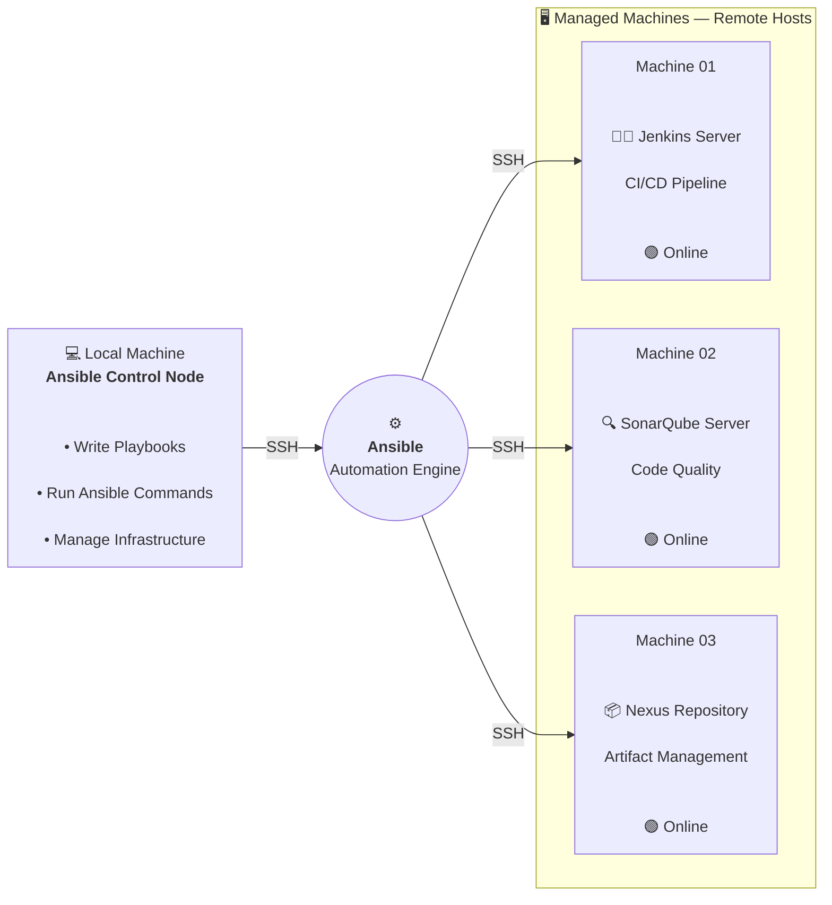

# DevOps Infrastructure as Code (IaC) — Ansible Automation

**Project One** of the IaC final assignment: from a **local machine (Ansible control node)**, Ansible creates and manages **3 remote machines over SSH** — one for Jenkins, one for SonarQube, one for Nexus — and can destroy/reset the whole infrastructure again.

---

## 📌 Overview

| Machine | Service | Purpose |
|---|---|---|
| Machine01 | Jenkins | CI/CD pipeline |
| Machine02 | SonarQube | Code quality |
| Machine03 | Nexus Repository | Artifact management |

- Jenkins, SonarQube and Nexus run in **Docker**.
- Each service is reachable on its own **domain name with HTTPS** (Caddy reverse proxy + Let's Encrypt).
- Every machine gets the packages **Oh My Zsh, Portainer, GitHub CLI (gh) and tree**.


## 🏗️ Architecture Illustration



# 🎯 Project Objectives

Tasks from the assignment:

- A playbook that **creates the 3 machines with the requirement**
- A playbook that **resets (destroys) the infrastructure**
- Jenkins and Nexus installed **using Docker** (SonarQube too)
- Jenkins, SonarQube and Nexus each have a **domain name with HTTPS**
- Install packages on the machines: **omz, portainer, gh, tree**

## ✅ Status

- [x] Create machines — `playbooks/create-machine.yml`
- [x] Destroy / reset infrastructure — `playbooks/destroy-machine.yml`
- [ ] Install Docker + packages (omz, portainer, gh, tree)
- [ ] Deploy Jenkins, SonarQube, Nexus
- [ ] Domain names + HTTPS (Caddy)

---

# 🛠️ Technologies

| Technology | Purpose |
|---|---|
| Ansible | Infrastructure automation |
| Docker | Container runtime |
| Docker Compose | Container orchestration |
| Jenkins | CI/CD |
| Nexus | Artifact repository |
| SonarQube | Code quality analysis |
| Caddy | Reverse proxy & HTTPS |
| Portainer | Docker management |
| GitHub CLI | GitHub management |
| Zsh / Oh My Zsh | Shell environment |
| tree | Directory listing tool |
| Git | Version control |
| sslip.io | Free domain names that resolve to the VM IP |
| Google Cloud (GCE) | Hosts the 3 machines |

---

# 📁 Project Structure

```
.
├── ansible.cfg                  # Ansible defaults (inventory, SSH key)
├── inventory.ini                # Generated by create-machine.yml
├── playbooks/
│   ├── create-machine.yml       # Create GCP VMs + generate inventory
│   └── destroy-machine.yml      # Delete GCP VMs + reset inventory
├── templates/
│   └── inventory.j2             # Inventory template (one group per role)
└── vars/
    └── machine-info.yml         # GCP project, machine specs, machine list
```

---

# 🍎 Prerequisites (macOS control node)

```bash
brew install ansible
brew install --cask google-cloud-sdk

# GCP libraries go into Homebrew Ansible's own Python environment
"$(brew --prefix ansible)/libexec/bin/python" -m ensurepip
"$(brew --prefix ansible)/libexec/bin/python" -m pip install requests google-auth
ansible-galaxy collection install google.cloud

# Credentials used by the playbooks (~/.config/gcloud/application_default_credentials.json)
gcloud auth application-default login
gcloud config set project devops-505705
```

An SSH key at `~/.ssh/id_ed25519(.pub)` is required; its public key is injected into every VM.

---

# 🚀 Usage

```bash
# Create the VMs and generate inventory.ini
ansible-playbook playbooks/create-machine.yml

# Check connectivity
ansible all -m ping

# Destroy the VMs and reset inventory.ini
ansible-playbook playbooks/destroy-machine.yml

# ...and also delete the allow-ssh / allow-http-https firewall rules
ansible-playbook playbooks/destroy-machine.yml -e delete_firewall=true
```


# 🖥️ Infrastructure

Each service runs on its own machine. GCP requires lowercase VM names, so the machines from the illustration are named after their service:

| Illustration | VM name | Inventory group | Service | URL |
|---|---|---|---|---|
| Machine01 | `jenkins01` | `[jenkins]` | Jenkins (Docker) | `https://jenkins.<ip-dashed>.sslip.io` |
| Machine02 | `sonarqube01` | `[sonarqube]` | SonarQube (Docker) | `https://sonarqube.<ip-dashed>.sslip.io` |
| Machine03 | `nexus01` | `[nexus]` | Nexus (Docker) | `https://nexus.<ip-dashed>.sslip.io` |

The machines are defined in `vars/machine-info.yml`: e2-standard-2 (2 vCPU / 8 GB), 50 GB disk, Ubuntu 24.04.

### Domains & HTTPS

[sslip.io](https://sslip.io) turns any IP into a domain with no DNS setup, e.g. `jenkins.34-21-205-177.sslip.io` → `34.21.205.177`. Caddy on each machine requests a Let's Encrypt certificate for that domain and proxies to the service container. Ports 80/443 are opened by the `allow-http-https` firewall rule that `create-machine.yml` creates.

### Generated inventory

`create-machine.yml` writes `inventory.ini` from `templates/inventory.j2`:

```ini
[localhost]
master ansible_host=localhost ansible_connection=local

[jenkins]
jenkins01 ansible_host=<IP>

[sonarqube]
sonarqube01 ansible_host=<IP>

[nexus]
nexus01 ansible_host=<IP>

[all:vars]
ansible_user=g700ghosty
```

---
